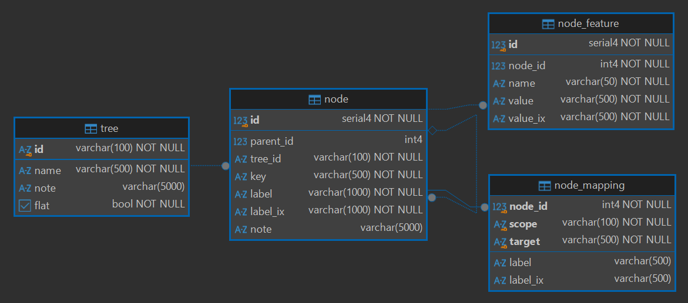

# Taxonomies

- 🌐 [taxonomies store](https://github.com/vedph/taxo-store)
- 🌐 [taxonomies UI shell](https://github.com/vedph/taxo-store-shell)

- [Taxonomy Trees](#taxonomy-trees)
  - [Store](#store)
  - [Data Source](#data-source)

In most cases, taxonomies in Cadmus are relatively static and small data, defined via [thesauri](thesauri). Some projects anyway have more specialized requirements for specific taxonomies which could not be optimally satisfied by thesauri alone.

For instance, consider a huge taxonomy about iconographic subjects, including a deep hierarchy of thousands of entries. In this scenario, we would have these requirements:

- **manage large data** with optimal performance: usually these taxonomies are large, while thesauri are designed for relatively small set of flat or hierarchical data, providing closed data sets for the UI.
- **edit with high granularity**: thesauri are edited as a set, while in the example scenario users might want to edit single entries from a taxonomy. For instance, it might happen that while describing an iconography, users do not find a proper term in the taxonomy, and would want to add a new one. In this case, we need per-entry editing, as such taxonomy is large and shared, so that it might even be edited concurrently.

In these cases, Cadmus can adopt a [taxonomies store](https://github.com/vedph/taxo-store). This is an independent system, which can be used even outside Cadmus, backed by a PostgreSQL database including trees and nodes.

In this store, each taxonomy is a tree with 1 or more root nodes; so it could be a flat list as well as a hierarchical list (which happens in most cases). Users can browse and find nodes in a tree, and edit it. To provide an easy experience, each tree (=taxonomy) has a string identifier and a human-friendly name, and each node has a string key and a human-friendly label. Internally, nodes use numeric IDs for performance reasons; but the software layer interacting with the database provides access to nodes via keys, which are designed to be unique within a single tree (Figure 1).

- _Figure 1 - The taxonomy store database schema_

Thus, to provide a global node identifier, the convention is using the tree ID (a string) + `/` + the node's key (a string). Of course, while working in the scope of a single tree a node key is enough.

The taxonomies subsystem provides:

- full backend logic to manage taxonomies.
- API endpoints ready to be integrated in your API.
- [frontend components](https://github.com/vedph/taxo-store-shell) to integrate in your frontend. Cadmus provides a part editor based on these components.
- a Cadmus part, [taxonomies store tree nodes part](https://github.com/vedph/taxo-store/blob/master/docs/taxo-store-nodes.md), provides a ready to use part which allows user to pick nodes from any specific tree, while also editing it. This part lets you pick any number of node IDs from a single tree. The tree is specified as the part's role ID, and lookup and editing parameters can be customized via backend settings for each combination of part type ID and part role ID.

## Data Source

Taxonomies can have any data source. A CSV-based importer is provided, so that you can fully instantiate a taxonomies store by just providing a set of CSV files in your Cadmus API: the API will take care of creating the database if not found, and populating it from the CSV files.

From a user standpoint, taxonomies can be either hierarchical (a tree) or flat (a flat list). From the data model standpoint, all taxonomies are tree structures, because they accommodate both hierarchical and flat structures: a flat list is just a tree having only root-level nodes.

This is why internally every taxonomy is defined a **tree**, and every entry in it is defined a **node**.

Each tree and node is identified by a **string ID**. Internally numbers are used for better performance and smaller size.

🔑 As for **string identifiers**, the usual convention is:

- the only allowed characters are letters a-z (always lowercase, no diacritics), digits, `_`, `-`, `.`. Spaces are not allowed!
- use `_` to replace spaces and reserve `-` to logically separate ID parts. For instance `pg.anti-scomunicati-negligenti` corresponds to _Purgatorio: antipurgatorio, scomunicati, negligenti_ (where there are 3 listed places); `pg.anti-valletta_principi` corresponds to _Purgatorio: valletta dei principi_ (where `_` is like a space within a single listed place, _valletta principi_).
- use `.` to separate branches in a hierarchical tree (the corresponding separator in the label is `:`), e.g. `if.`=_Inferno_, `if.selva`=_Inferno: Selva_, etc.

All taxonomies are imported into the editor database from CSV files (comma separated values). ⚠️ Remember that when you have a comma in a string you must wrap the string in `""` to avoid the comma being misinterpreted as a column separator.

> The editor allows you to define your own filtering function to automatically generate the key from the label.

### Tree Files

Tree files have these **columns**:

- `id`: a string with the taxonomy ID.
- `name`: the taxonomy name. This will appear in the UI.
- `note`: a short descriptive note for the taxonomy.
- `flat`: t

### Node Files

Each tree listed in this file has a corresponding nodes file. Node files have these **columns**:

- `tree_n`: the tree ID they belong to.
- `parent_key`: used only for non-flat trees, it is the key of the parent node.
- `key`: the node's key. This is a string identifier which must be unique within that tree.
- `label`: the human-friendly label for the node.
- `filtered_label`: leave this empty except for corner-case indexing. This is the string which is used to index the entry for lookup search; if not specified, it will be automatically generated by filtering the label (e.g. remove diacritics, lowercase letters, etc.). In some very special cases you might need to provide a non-predictable indexed form (e.g. "zerozerosette" for "007").
- `flags`: this is usually empty. You can use this to include any number of characters where each character is a boolean flag. For instance, in organizations we can define a letter for each subtype: `F`=family, etc. These flags can be used during lookup to further limit the lookup scope.
- `note`: a free text note (max 5000 characters).

### Mapping Files

For each entry you can specify any number of mappings to other external authority files (VIAF, Biblissima+, etc.). This way we maintain a single facade as our own taxonomy, which then acts as a hub aggregating all the mappings to equivalent external entities; and this mapping needs to be done only once.

To this end, we create a `mappings.csv` file with these columns:

- `tree_n`: the tree numeric ID.
- `node_key`: the node key to map.
- `scope`: the scope of the external target, e.g. `viaf`, `biblissima`, etc.
- `target`: the target ID in the external authority file.
- `label`: a human-friendly label for the target.
- `filtered_label`: leave this empty except for corner-case indexing, as for node files.

> When using lookup from within the editor to add mappings, scope and label will be automatically derived from the picked target.
